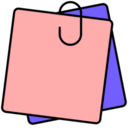
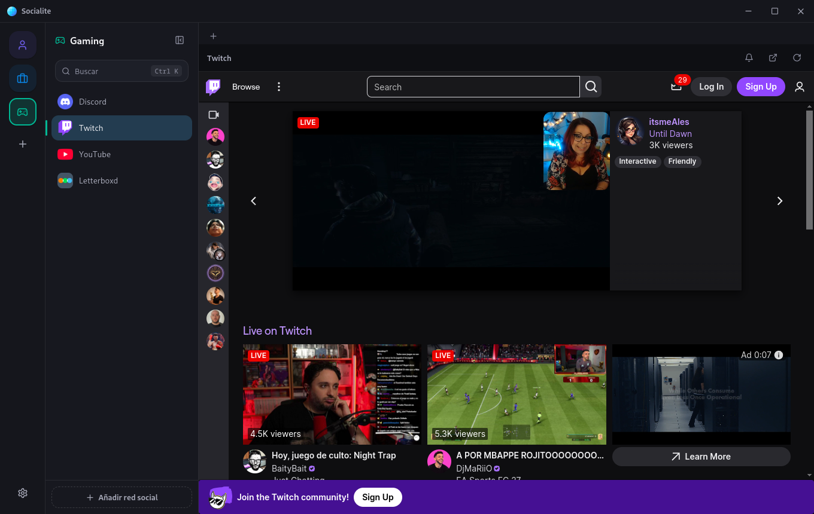
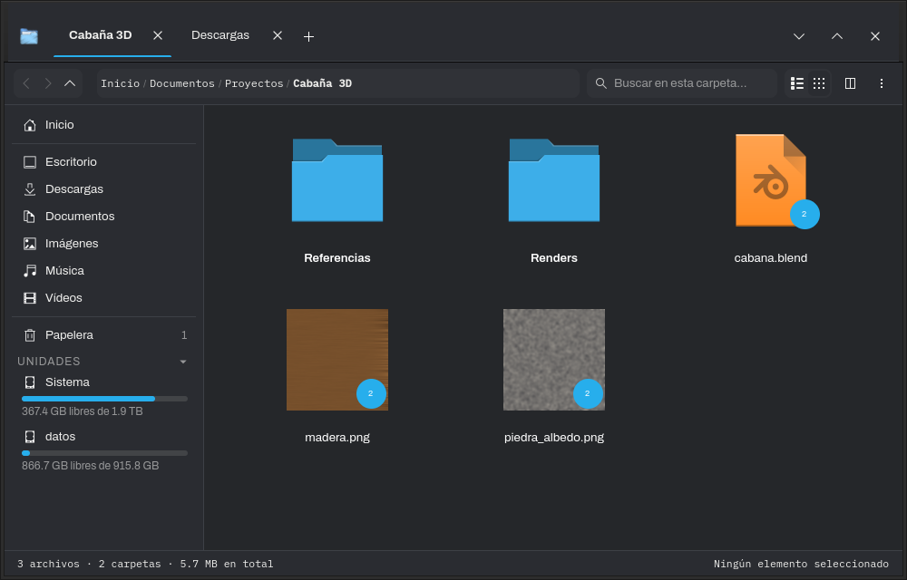
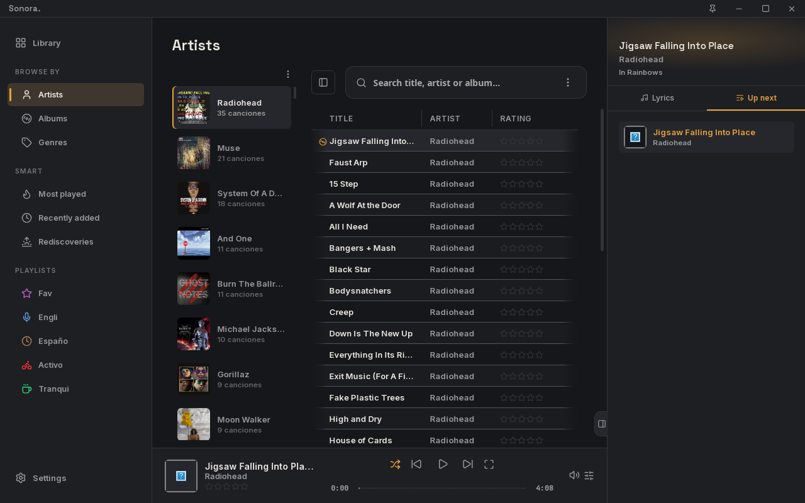
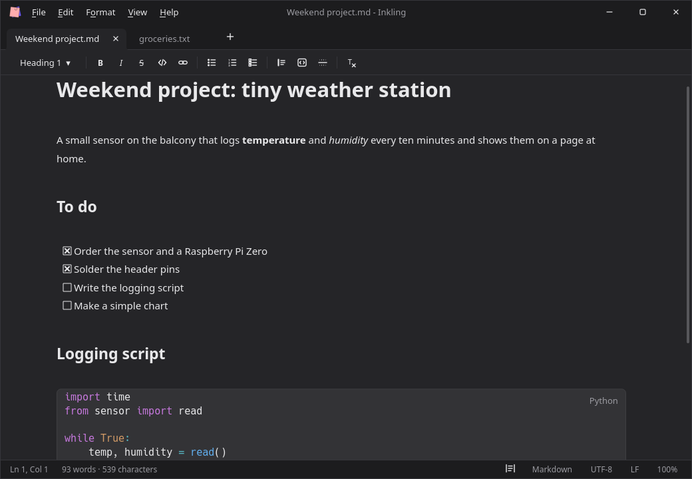
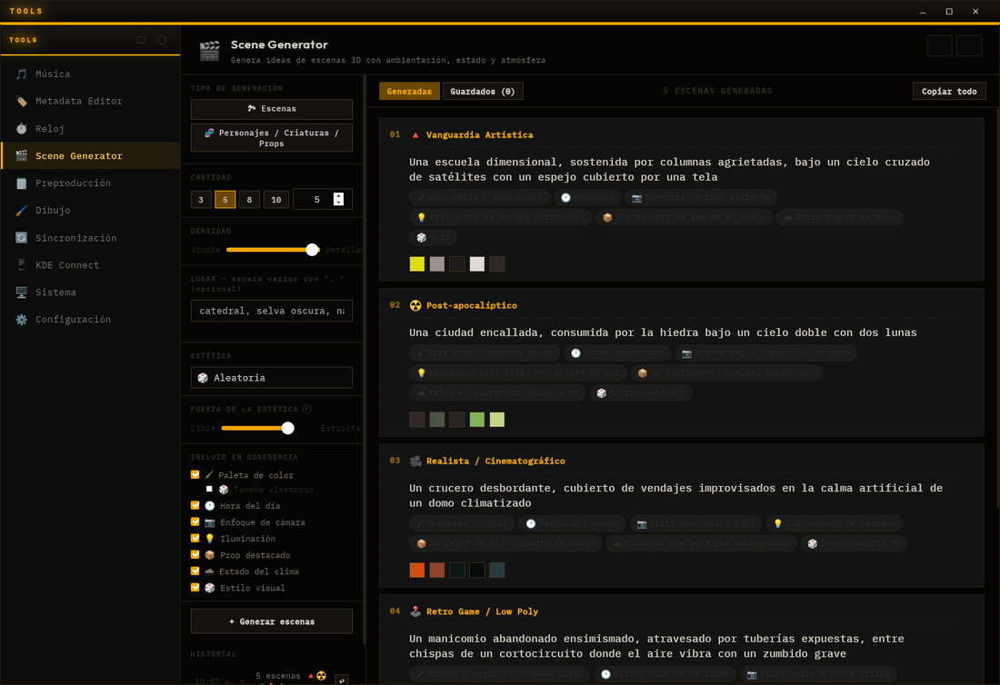

# Apps

Apps I make and use every day: notes, music, files, messaging, creative tools and a couple of apps for your phone. They're all free. Each one has its own page with downloads, instructions and release notes.

| | App | What it is | Windows | Linux | macOS | Android |
|:-:|---|---|:-:|:-:|:-:|:-:|
|  | [**Onyx**](https://github.com/Amariless/Onyx-releases) | The comfort of Notion, in notes that live on your computer | ✓ | ✓ | — | ✓ |
|  | [**Socialite**](https://github.com/Amariless/Socialite-Releases) | Your chats and social networks in one window, with profiles | ✓ | ✓ | — | — |
|  | [**Waypoint Explorer**](https://github.com/Amariless/waypoint-explorer-releases) | A file manager that does what others leave to you | — | ✓ | — | — |
|  | [**Sonora**](https://github.com/Amariless/Sonora-releases) | A music player for the songs you own | ✓ | ✓ | — | — |
|  | [**Inkling**](https://github.com/Amariless/Inkling-releases) | A fast, light notepad for Markdown and plain text | ✓ | ✓ | — | — |
|  | [**Atelier**](https://github.com/Amariless/Atelier-releases) | A creative toolbox for your desktop | ✓ | ✓ | — | — |
|  | [**Atelier Mobile**](https://github.com/Amariless/atelier-mobile-releases) | A Swiss Army knife for your phone | — | — | — | ✓ |
|  | [**Wake up**](https://github.com/Amariless/Wake-up-releases) | A study planner with alarms you can't turn off half asleep | — | — | — | ✓ |
|  | [**Emojify**](https://github.com/Amariless/Emojify-releases) | An emoji picker for KDE Plasma | — | ✓ | — | — |

---

<table>
  <tr>
    <td width="50%" valign="top">
      
      <h3> Onyx</h3>
      
A notes app with everything that makes Notion comfortable: blocks, pages inside pages, databases, a graph of your ideas. Every page is a plain Markdown file in a folder you own, and it opens Obsidian vaults as they are.

      
<b>Windows · Linux · Android</b> — <a href="https://github.com/Amariless/Onyx-releases">Download</a>

    </td>
    <td width="50%" valign="top">
      
      <h3> Socialite</h3>
      
WhatsApp, Telegram, Discord, Instagram and 35+ more in one desktop app. Separate profiles for work and personal life, any website as a custom tab, and you stay logged in.

      
<b>Windows · Linux</b> — <a href="https://github.com/Amariless/Socialite-Releases">Download</a>

    </td>
  </tr>
  <tr>
    <td width="50%" valign="top">
      
      <h3> Waypoint Explorer</h3>
      
Rename any app on your system, keep related files grouped together, leave notes on files and see your installed apps and games right in Downloads. Plus tabs, split view and archives as folders.

      
<b>Linux</b> — <a href="https://github.com/Amariless/waypoint-explorer-releases">Download</a>

    </td>
    <td width="50%" valign="top">
      
      <h3> Sonora</h3>
      
Synced lyrics, a full-screen cinema mode with visualizations, smart playlists and themes down to the last detail, even Winamp skins. Fast, offline and made for the music you own.

      
<b>Windows · Linux</b> — <a href="https://github.com/Amariless/Sonora-releases">Download</a>

    </td>
  </tr>
  <tr>
    <td width="50%" valign="top">
      
      <h3> Inkling</h3>
      
A notepad that opens in an instant, formats Markdown as you type, highlights code in 28 languages and never loses what you write, even if you never saved it.

      
<b>Windows · Linux</b> — <a href="https://github.com/Amariless/Inkling-releases">Download</a>

    </td>
    <td width="50%" valign="top">
      
      <h3> Atelier</h3>
      
Music downloads and tagging, drawing, pre-production, a scene idea generator, focus timers, phone and folder sync, and system tools, all in one window.

      
<b>Windows · Linux</b> — <a href="https://github.com/Amariless/Atelier-releases">Download</a>

    </td>
  </tr>
  <tr>
    <td width="50%" valign="top">
      
      <h3> Emojify</h3>
      
Press Meta+., search in English or Spanish and the emoji is typed right where you were writing. Made for KDE Plasma 6.

      
<b>Linux (KDE Plasma 6)</b> — <a href="https://github.com/Amariless/Emojify-releases">Download</a>

    </td>
    <td width="50%" valign="top">
      <h3> Atelier Mobile</h3>
      
Music downloads, a PDF and EPUB reader, expenses, quick notes, color palettes from photos and 3D textures from your camera. No accounts or ads.

      
<b>Android 7.0+</b> — <a href="https://github.com/Amariless/atelier-mobile-releases">Download</a>

       
      <h3> Wake up</h3>
      
Classes, schedules and assignments for the semester, with alarms you can only turn off by solving a challenge, and a daily limit for Reels and TikTok.

      
<b>Android 8.0+</b> — <a href="https://github.com/Amariless/Wake-up-releases">Download</a>

    </td>
  </tr>
</table>

---

The source code of these apps is private; their repositories only host the installers. Found a problem or have an idea? Each app's page has a short form for bugs, ideas and comments.
