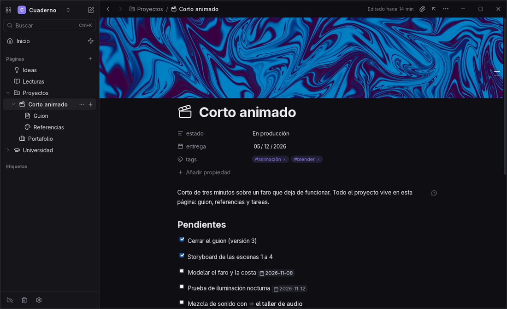
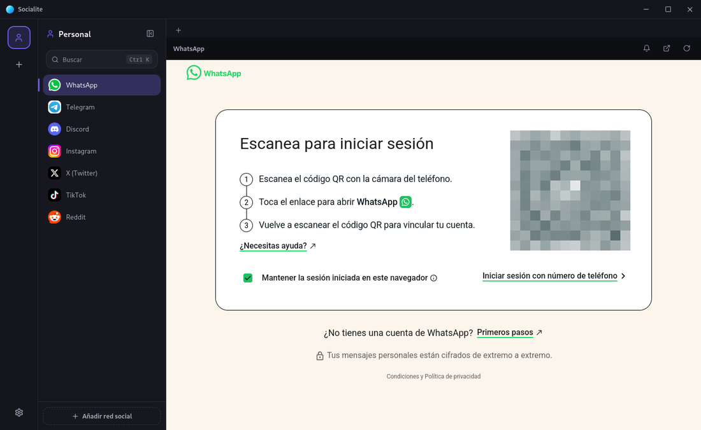
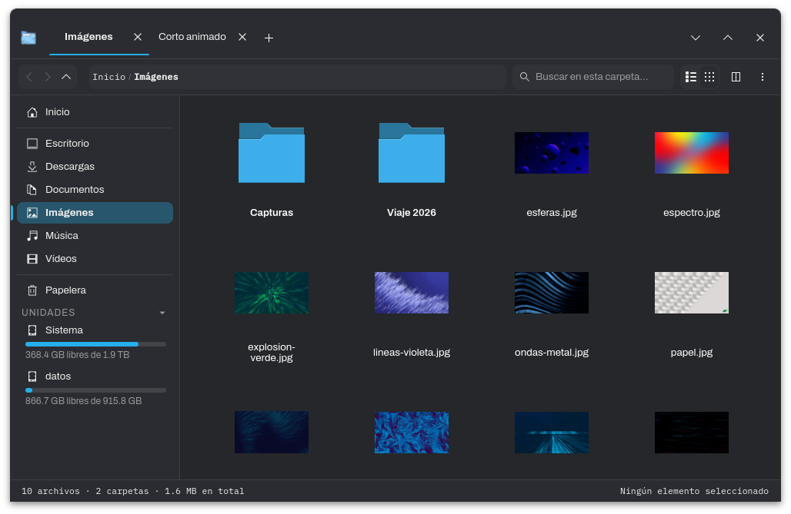
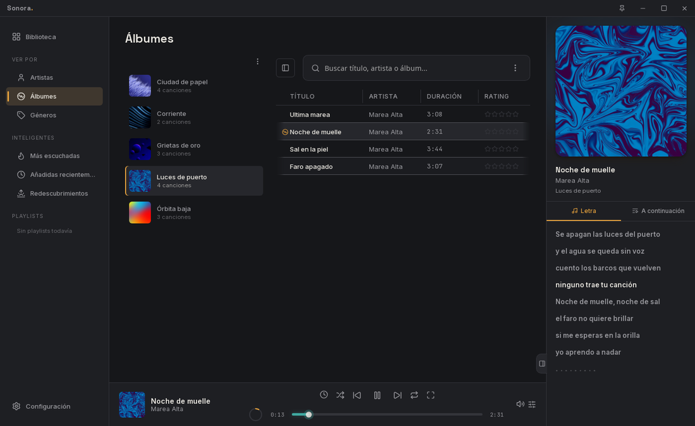
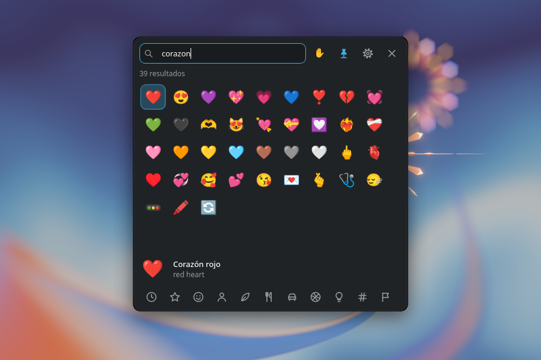

# Apps

Aplicaciones que hago para usar todos los días: notas, música, archivos, mensajería, herramientas creativas y un par de apps para el celular. Todas son gratis. Cada una tiene su propia página con las descargas, las instrucciones y las notas de cada versión.

| | App | Qué es | Windows | Linux | macOS | Android |
|:-:|---|---|:-:|:-:|:-:|:-:|
|  | [**Onyx**](https://github.com/Amariless/Onyx-releases) | Notas al estilo Notion guardadas como archivos Markdown | ✓ | ✓ | — | ✓ |
|  | [**Socialite**](https://github.com/Amariless/Socialite-Releases) | Chats, redes y correo en una sola ventana | ✓ | ✓ | — | — |
|  | [**Explorador**](https://github.com/Amariless/explorador-releases) | Explorador de archivos para Linux | — | ✓ | — | — |
|  | [**Sonora**](https://github.com/Amariless/Sonora-releases) | Reproductor para tu música local | ✓ | ✓ | — | — |
|  | [**Atelier**](https://github.com/Amariless/Atelier-releases) | Herramientas creativas y de uso diario en una app | ✓ | ✓ | — | — |
|  | [**Alejo Tools Mobile**](https://github.com/Amariless/alejo-tools-mobile-releases) | Varias herramientas pequeñas para el celular | — | — | — | ✓ |
|  | [**Wake up**](https://github.com/Amariless/Wake-up-releases) | Agenda de estudio y alarmas con retos | — | — | — | ✓ |
|  | [**Emojify**](https://github.com/Amariless/Emojify-releases) | Selector de emojis para KDE Plasma | — | ✓ | — | — |

---

##  Onyx

Una app de notas que se siente como Notion pero guarda todo como archivos `.md` en tu equipo. Escribes en bloques, enlazas páginas, llevas tareas y armas bases de datos, sin cuenta ni nube obligatoria. Abre vaults de Obsidian tal cual.

**Windows · Linux · Android** &nbsp;—&nbsp; [Descargar](https://github.com/Amariless/Onyx-releases/releases/latest)

##  Socialite

WhatsApp, Telegram, Discord, Instagram, Gmail y más de 35 servicios en una app de escritorio. Separa tus cuentas en perfiles (Personal, Trabajo), mantiene las sesiones abiertas y te avisa con notificaciones del sistema.

**Windows · Linux** &nbsp;—&nbsp; [Descargar](https://github.com/Amariless/Socialite-Releases/releases/latest)

##  Explorador

Un explorador de archivos para Linux con pestañas, vista dividida, miniaturas de casi cualquier formato y comprimidos que se abren como carpetas. Además deja notas en archivos, encuentra duplicados y muestra qué ocupa espacio en el disco.

**Linux** &nbsp;—&nbsp; [Descargar](https://github.com/Amariless/explorador-releases/releases/latest)

##  Sonora

Un reproductor para la música que tienes en archivos. Arma tu biblioteca sola, muestra letras sincronizadas, trae ecualizador con perfiles para tus audífonos y acepta skins de Winamp.

**Windows · Linux** &nbsp;—&nbsp; [Descargar](https://github.com/Amariless/Sonora-releases/releases/latest)

##  Atelier

Junta en una ventana herramientas para proyectos audiovisuales y para el equipo: guion y storyboard, generador de ideas de escenas, dibujo, descarga y etiquetado de música, reloj, sincronización con Syncthing y monitor del sistema.

**Windows · Linux** &nbsp;—&nbsp; [Descargar](https://github.com/Amariless/Atelier-releases/releases/latest)

##  Alejo Tools Mobile

Una navaja suiza para Android: descarga de música, registro de gastos, ideas rápidas, lector de PDF y EPUB, paletas de color a partir de fotos y un creador de texturas para 3D. Sin cuentas ni publicidad.

**Android 7.0 o superior** &nbsp;—&nbsp; [Descargar](https://github.com/Amariless/alejo-tools-mobile-releases/releases/latest)

##  Wake up

Materias, horarios y tareas del semestre, con recordatorios antes de cada entrega. Las alarmas solo se apagan resolviendo un reto: agitar el celular, una cuenta o escribir una frase. También mide tu tiempo de pantalla y le pone límite a los Reels.

**Android 8.0 o superior** &nbsp;—&nbsp; [Descargar](https://github.com/Amariless/Wake-up-releases/releases/latest)

##  Emojify

Pulsas Meta+., buscas el emoji en español o inglés y aparece escrito en la ventana donde estabas: WhatsApp Web, Discord, la terminal. Hecho para KDE Plasma 6.

**Linux (KDE Plasma 6)** &nbsp;—&nbsp; [Descargar](https://github.com/Amariless/Emojify-releases/releases/latest)

---

El código fuente de estas apps es privado; en sus repositorios se publican solo los instaladores. Si encuentras un problema, abre un issue en el repositorio de la app.
